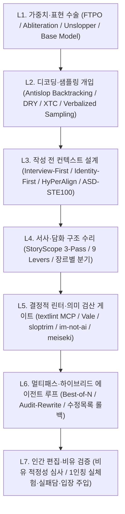

# 글로벌 AI Slop(AI 투·AI 냄새·AI 味) 제거 스킬·기법 백과사전 (EN · KO · JA · ZH)

> **조사 기준일:** 2026-11-23 | **검증 범위:** GitHub 공개 저장소 원문(`SKILL.md`/`README.md`) 20편 직접 열람 · GitHub API 30+ 저장소 실측 · OpenAlex/arXiv API 35+ 논문 서지·DOI 검증 · Wikipedia `WP:AISIGNS` API · 4개 언어권 SNS/커뮤니티(Reddit, X, Zenn, Note, GPTERS, ArcaLive, Threads, 知乎 등) 교차 점검

---

## 1. 핵심 요약: 2024 → 2026 AI Slop 제거의 3가지 변화

2023~2024년에 널리 쓰인 *"delve, tapestry 같은 금지어 목록을 프롬프트에 넣는다"* 방식은 **2025~2026년 대규모 실증 연구에서 한계가 드러났습니다.** GitHub 오픈소스 스킬, ICLR·NeurIPS·CHI·PNAS 논문, 로컬 LLM 커뮤니티에서 공통으로 확인된 3가지 변화는 다음과 같습니다.

> [!IMPORTANT]
> **2026년 실증 연구의 3가지 발견**
> 1. **어휘보다 서사·구조 지문이 훨씬 강하다 (`StoryScope`, `arXiv:2604.03136` / `SlopShape`, `arXiv:2609.15369`):** 61,608편의 소설 대조 연구에서 인간 편집자가 표층 문체·상투어를 모두 고친 뒤에도, 서사 구조만 보는 분류기의 AI 탐지율은 **95.5% → 93.9%**로 겨우 1.6%p만 떨어졌습니다. 기업 블로그 2,250편 vs AI 미러 11,250편 대조에서도 구조 특징만으로 **98.0 macro-F1**로 분리되었습니다.
> 2. **탐지기가 잡는 것은 'AI 자체'가 아니라 'RLHF/지시 튜닝 문체'다 (`Base Models Look Human`, `arXiv:2605.19516`):** 비튜닝 베이스 모델의 출력은 현행 SOTA 탐지기에서 인간 글로 판정됩니다. 실제로 탐지기와 독자가 거부감을 느끼는 요소는 RLHF가 만든 *과잉 정중함, 양비론 균형 맞추기, 과잉 목록화, 도우미 어조*입니다.
> 3. **모델마다 AI 지문의 방향이 정반대이며 구세대 금기어는 이미 만료됐다 (`lieflat-less-ai-tone` 520만 자 코퍼스 실측 / `WP:AISIGNS` 2026 개정):**
>    - 2026년 중국어 520만 자 실측에서 엠대시(`——`)는 **Claude Opus 4.6에서 δ = +0.95(전편 등장)**인 반면 **GPT-5.6에서는 δ = −0.54(인간보다 적음)**으로 방향이 정반대였습니다.
>    - 구세대 단골 금지어였던 `"首先/其次/总之"`(δ = +0.02)와 `"赋能/闭环/抓手"`(δ = +0.10)는 최신 모델에서 변별력이 소멸했고, 영어 위키백과(`Wikipedia:Signs of AI writing`) 역시 **`Overuse of em dashes (2022–September 2026)`**와 **`Promotional language (2023–2025)`**를 **과거 지표(Historical indicators)**로 이동시켰습니다.

### 7계층 AI Slop 제거 풀스택 (The 7-Layer Anti-Slop Stack)

---

## 2. 7계층별 제거 기법 상세

### Layer 1. 모델 가중치 & 내부 표현 수술 (Weights & Representation Level)

**모델 자체의 Slop 생성 성향을 직접 줄이는** 계층입니다.

1. **FTPO (Final Token Preference Optimization)** (Paech et al., ICLR 2026, [arXiv:2510.15061](https://doi.org/10.48550/arxiv.2510.15061))
   - 기존 DPO는 문체 다양성과 일반 지능(MMLU/GSM8K)을 훼손하는 부작용이 있습니다.
   - FTPO는 추론 트레이스에서 금지 패턴이 촉발되는 **최종 분기 토큰의 로짓(logit)만 선별해 선호도 최적화**함으로써 일반 벤치마크 성능을 유지·향상시키면서 반복적 Slop만 크게 억제합니다.
2. **학습 없는 활성화 방향 절제 (Activation Abliteration for Slop)** (`u/-p-e-w-`, [r/LocalLLaMA](https://www.reddit.com/r/LocalLLaMA/comments/1qa0w6c/it_works_abliteration_can_reduce_slop_without/), `p-e-w/heretic`)
   - 원래 검열/거부(refusal) 방향 제거에 쓰이던 Arbitrary-Rank Ablation 도구 `p-e-w/heretic`을 반전 응용했습니다.
   - *화려한 Slop 프롬프트* vs *건조한 Non-Slop 프롬프트* 대조쌍을 주입해 잔차 스트림(residual stream)에서 Slop 벡터 방향(예: Mistral Nemo 7~10층)을 제거하여 **파인튜닝 없이** 과잉 수식·클리셰를 줄입니다(`p-e-w/Mistral-Nemo-Instruct-2407-heretic-noslop`).
3. **역-슬롭화 파인튜닝 (Reverse-Enslop Training)** (`u/N8Karma`, [r/LocalLLaMA](https://www.reddit.com/r/LocalLLaMA/comments/1qd88v2/i_trained_a_model_to_unslop_ai_prose/))
   - Project Gutenberg 인간 고전 원문을 GPT-4o-mini로 의도적으로 **10배 과장·슬롭화(enslop)**한 뒤 `[slop] → [original human prose]` 쌍으로 모델을 학습(`N8Programs/Unslopper-30B-A3B`)합니다. Pangram 인간성 점수를 `0 → 0.481`로 끌어올렸습니다.
4. **편집 기반 글쓰기 보상 정렬 (Edit-Based Writing Rewards / LAMP)** (Chakrabarty, Laban, & Wu, CHI 2025, [doi:10.1145/3706598.3713559](https://doi.org/10.1145/3706598.3713559))
   - 전문 작가들이 AI 초안을 직접 고친 편집 이력(edits)을 데이터화해 AI 특유 버릇(과잉 설명, 추상 명사 3연속, 상투적 결말)의 분류체계를 정립하고, 편집 기반 보상 모델로 모델을 재정렬합니다.
5. **베이스 모델(Non-RLHF) 패러프레이징** (Xu et al., 2026, [arXiv:2605.19516](https://doi.org/10.48550/arxiv.2605.19516))
   - RLHF 정렬이 되지 않은 사전학습 베이스 모델(Completion 모드)로 초안을 이어쓰기·재서술하면 RLHF 특유의 아첨·목록화·완곡어법 지문이 원천 배제됩니다.

---

### Layer 2. 디코딩 & 샘플링 개입 (Inference & Decoding Level)

가중치를 유지한 채 **토큰 생성 시점의 확률 분포**를 제어하는 기법입니다.

1. **Antislop 백트래킹 샘플러 (`sam-paech/antislop-sampler`, KoboldCpp v1.76+, ExLlamaV2 `banned_strings`)**
   - 원문 발췌 ([antislop-sampler README](https://github.com/sam-paech/antislop-sampler)):
     > *"So instead, we wait for the whole phrase to appear in the output, then backtrack and downregulate all the tokens that could have produced the slop phrase, and continue from there."*
   - 단순 토큰 단위 `logit_bias`는 멀티토큰 단어(예: `Elara` = `["El", "ara"]`)의 앞 토큰을 막아 무고한 단어까지 망가뜨립니다. Antislop 샘플러는 금지 구문이나 **정규식(`regex_bans`, 예: `not X, but Y`)**이 완성되는 순간 직전 분기점으로 **백트래킹**해 시작 토큰 확률만 감쇠 후 재생성하므로 수천 개 금지 구문을 품질 저하 없이 억제합니다.
2. **DRY (Don't Repeat Yourself) + XTC (Exclude Token Consideration) + Min-P 샘플러 조합** (`llama.cpp` / KoboldCpp / SillyTavern 커뮤니티 표준)
   - **DRY:** 최근 생성된 n-gram 시퀀스 반복에 지수 페널티를 부여해 *"shiver down spine / ozone / testament"* 류의 재발을 차단합니다(통상 `multiplier 0.8~0.9`, `base 1.75~2.0`, `allowed_length 2`, `sequence_breakers: \n : " *`).
   - **XTC:** 문맥상 가장 뻔한 최상위 확률 토큰들을 확률적으로 제외(`probability 0.10~0.20`, `threshold 0.005~0.01`)하여 AI 특유의 평균 회귀(going to the mean) 어휘를 깨뜨립니다.
   - **주의 (Repetition Penalty 함정):** `repetition_penalty` 적용 범위(range)가 컨텍스트 전체로 너무 넓으면 모델이 패널티를 피하려 오히려 기괴한 유의어(*ozone, tapestry, labyrinth*)로 폭주하므로 `512~1024` 토큰으로 제한하는 것이 정석입니다.
3. **Verbalized Sampling (언어화 샘플링, VS)** (Zhang, Manning, Shi et al., 2025, [arXiv:2510.01171](https://doi.org/10.48550/arxiv.2510.01171))
   - RLHF 선호 데이터의 **전형성 편향(typicality bias)**이 모드 붕괴(mode collapse)를 일으킨다는 점을 규명하고, **추가 학습 없이** 프롬프트에서 *"후보 5개와 각각의 확률 분포를 함께 출력하라"*고 지시해 꼬리 분포(저확률·독창적 표현)를 복원합니다. 창작 다양성이 **1.6~2.1배** 증가합니다.
4. **고엔트로피 디코딩 변주 & 추론 시점 보상 앙상블**
   - **RAID (`arXiv:2405.07940`):** 신규 생성 시 `temperature 0.9–1.1`, `top_p 0.95–0.99`로 탐지 가능성 및 어휘 균질성 완화.
   - **SLOP Inference-Time Alignment (`arXiv:2605.13537`):** 참조 모델 온도 보정과 생성형 보상 모델 앙상블(Sharpened Logarithmic Opinion Pool)로 RLHF 보상 해킹(장황함·아첨)을 추론 단계에서 억제.

---

### Layer 3. 작성 전 컨텍스트 & 입력 엔지니어링 (Pre-Drafting Level)

4개 언어권 실무자들이 공통으로 강조하는 출발점은 **"빈 도화지에서 AI에게 바로 초안을 시키는 순간(ポン出し) Slop은 이미 확정된다"**는 사실입니다.

1. **인터뷰 우선(Interview-First) & 음성 전사(Voice-to-Text) 원재료 주입**
   - 초안 생성 전 AI가 사용자에게 구체적 경험·수치·실패담·입장을 **1문 1답으로 인터뷰**하거나, 사용자가 3분간 구술(STT)한 날것의 메모를 유일한 팩트 소스로 고정합니다.
   - 한국 커뮤니티(지피터스·벨로그)의 **"선(先) 컨텍스트, 후(後) 프롬프트"**, 일본 Note.com의 **"소재 부족 시 사전 인터뷰"** 전략이 동일 원리입니다.
2. **정체성 우선 4단계 프롬프트 순서 (`Nanako0129/sepia`)**
   - 원문 발췌 ([sepia README](https://github.com/Nanako0129/sepia)):
     > *"The order that worked: 1. Identity first. 2. Facts separately, as the only source. 3. Constraints stated as platform limits, with the structure left to the model. 4. sepia as the check."*
   - 목차·불릿 뼈대(skeleton)를 미리 쥐여주면 모델이 "양식 채우기(form-filling)" 모드로 전환되어 Slop이 급격히 늘어납니다. **누가 누구에게 말하느냐(Identity)**와 **팩트 원천(Facts)**을 분리하고, 물리적 플랫폼 제약(글자 수·마크업)만 준 뒤 구조는 열어두면 글이 훨씬 자연스럽습니다.
3. **Andrej Karpathy의 ASD-STE100 (80% 통제 기술영어) 기법** (`Dodaios/ste80-humanizer` 1k★, 지피터스 한국어판)
   - 2026년 10월 2일 Karpathy의 X 포스트([x.com/karpathy/status/2105819303471976479](https://x.com/karpathy/status/2105819303471976479)) 원문:
     > *"Ask your LLM to explain something in ASD-STE100, it's a controlled language specification originally developed for aerospace maintenance documentation... Sometimes I've tried to soften it a bit e.g. ask for '80% of the way to ASD-STE100' because the spec is quite stringent."*
   - 항공기 정비 매뉴얼용 통제 언어 규격(ASD-STE100 Issue 9)을 80% 강도로 적용합니다: **지시문 20단어/설명문 25단어 상한, 1문장 1아이디어, 조건 선행(`If X, do Y`), 능동태·단순시제, 1개념 1용어 고정(동의어 돌려쓰기 차단), 3단어 초과 명사 연쇄 금지, 문단당 최대 6문장, 세미콜론 금지.**
   - `ste80-humanizer`는 **Pass 1(`blader/humanizer` 26개 AI 티 제거) + Pass 2(STE80 15개 구조 규칙 S1~S15)** 2단 파이프라인으로 동작합니다.
4. **가설 기반 작가 문체 증류 (`HyPerAlign`, `arXiv:2505.00038` / `patina persona new`)**
   - "내 글 3편을 보고 비슷하게 써줘" 식으로 맡기는 대신, 본인 샘플에서 **명시적 스타일 가설**(문장 길이 분포, 쉼표/구두점 습관, 첫 문장 진입 방식, 절대 안 쓰는 어휘, 온기가 붙는 위치)을 먼저 JSON/마크다운 페르소나 문서로 추출·검증(`check_persona.py`)한 뒤 적용합니다.
5. **긍정 프레이밍 (Affirmative Framing: 핑크 엘리펀트 문제 회피)**
   - *"delve 쓰지 마, 불릿 쓰지 마"* 같은 부정 지시는 트랜스포머 어텐션에 금지 토큰을 오히려 활성화합니다.
   - 대안: *"불릿 금지"* → *"연결된 산문 문단으로만 작성하라"*; *"거창한 결론 금지"* → *"핵심 주장을 전달한 문장에서 즉시 글을 끝내라"*.

---

### Layer 4. 서사·담화·구조 수술 (Narrative & Discourse Architecture Level)

표층 단어 교체만으로 잡히지 않는 **깊은 구조적 Slop**을 교정하는 계층입니다.

1. **`StoryScope` 기반 3-Pass 구조 수리 (`Nanako0129/sepia`)**
   - **Pass 1 · 서사 아키텍처 (Fiction):** 해설자가 주제를 직접 설교하는 버릇 제거(AI 77% vs 인간 52%), 단선적 인과사슬 느슨화, 폭로/반전 후치, 신체 감각 클리셰(*가슴이 조여왔다* AI 81% vs 인간 38%) 탈피, 실제 지명·브랜드·금액 등 현실 고유명사 삽입(인간이 AI의 2배), 도덕적 모호성 허용.
   - **Pass 2 · 담화 흐름 (Discourse Flow):** 예측 가능한 문단-질문 전개(QUD) 해체, 중반부 처짐(mid-story sag) 교정, 지나치게 매끄러운 문단 연결 고의 단절(중국어 실측: 인간은 14문단마다 화제 점프, AI는 50문단당 1회).
   - **Pass 3 · 표층 스타일 (Surface Style):** 상투어·대구·구두점·어조 정리.
   - **황금률 (인간 분포 보정 원칙):** *"Calibrate to the human distribution, don't invert the AI one. Humans sit at moderate values; a story with every rule applied is a new fingerprint. The skill selects 3–5 moves per story and leaves slack."*
2. **9대 휴머나이징 레버 (`harshaneel/humanize`, 50+ 논문 종합)**
   1. **어휘 예측불가능성 주입 (Perplexity injection):** 문단당 1~2개 정확하지만 의외의 어휘 선택.
   2. **문장 길이 분산 강제 (Burstiness):** 150단어당 6단어 이하 초단문 1개 이상, 5단어 이내 차이의 문장 3연속 금지.
   3. **완곡어구 정리 (Hedge surgery):** 실질적 불확실성이 아니면 완곡어를 빼고, 실제로 불확실한 내용만 1인칭으로 명시.
   4. **구조 평탄화 (Structural flattening):** 주제문 재요약·강제 불릿·기계적 결론 제거.
   5. **구체성 앵커 삽입 (Specificity insertion):** 추상 명사마다 수치·시간·인물·도구명 부여.
   6. **화자 시점과 어조 (Voice & register):** 문맥에 맞는 1인칭·짧은 반문·사고 중 자가수정(`(사실 거의가 아니라 확실했다)`).
   7. **인간형 담화 접속 (Discourse coherence):** `Furthermore/Moreover` 삭제, 논리로 직접 연결.
   8. **구두점 정규화 (Punctuation):** 엠대시 300단어당 1회 상한, 세미콜론→마침표, 문장 중간 콜론(`The problem: ...`) 제거.
   9. **RLHF/지시 튜닝 보이스 박리 (Strip RLHF voice, 최상위 레버):** 요청하지 않은 양비론 트레이드오프, 질문 칭찬 오프너, 도우미 클로저, 과도한 완결성 제거.
3. **장르·도메인별 분리 규칙 (Venue-Matched Rules)**
   - **학술 논문 & 연구비 제안서 (`AIScientists-Dev/academic-humanizer` 5.8k★, `aigc-reduce` 758★):** 블로그용 휴머나이저를 논문에 돌리면 학술적 정밀도와 정당한 수동태·근거 기반 헤징까지 날아갑니다. **주장↔증거 강도 일치(`prove` → `show empirically`)**, 인용·수치·기호·수식 100% 보호, **"降重 ≠ 口语化(구어체화 금지)"**가 핵심입니다.
   - **기술문서·설계서 (`bamboo-nova/meiseki`, `sepia`):** *"자연스러움/목소리 추가"* 대신 **독해 부하 제거(이중부정·긴 관형절·연속 한자·명사화 해체)**와 **결론 우선·`file:line` 근거·블레임리스 포스트모템**에 집중합니다.

---

### Layer 5. 결정적 린터·정량 게이트·의미 검산 (Deterministic Linters & Fidelity Gates)

LLM에게 *"네가 쓴 AI 티를 스스로 고쳐봐"*라고만 맡기면 **자기 편향으로 놓치거나 반대로 사실을 왜곡·과윤문**합니다. 2026년 최상위 스킬들은 **결정적(Deterministic) 코드 린터 + 자동 복원 게이트**를 반드시 붙입니다.

| 도구 / 스킬 | 언어 | 결정적 검사 방식 | 핵심 방어 게이트 (환각·과윤문 차단) |
|---|---|---|---|
| **`@textlint-ja/preset-ai-writing`** (1.16k★) | JA | `textlint` + `kuromojin` 형태소 분석 + **`npx textlint --mcp`** 서버 | 표현이 아닌 **구조** 제약(`no-ai-colon-continuation`: 동사+콜론만 차단, 명사+콜론 허용) |
| **`bamboo-nova/meiseki`** | JA | 3층 아키텍처: `textlint` → (옵션) TypeSafe Jev 70배 고속 판정 → LLM 리라이트 | **의미 검산(`check:meaning`):** 리라이트 전후 부정 표지 홀짝성(이중부정 논리 반전 차단!), 수치·식별자·조건·확도 마커 대조 후 위험 문단 **자동 원문 복원** |
| **`epoko77-ai/im-not-ai`** (6.7k★) | KO | `prepare_monolith_input.py` 정량 사전 채점 → `route_hint`(light/std/heavy) | **결정적 어휘 복원(`lexical_layer.py restore`)** + `verify_gates.py`(변경률 30% 경고/50% 중단, **독립 2계열 발화** 오탐 차단) |
| **`larashero3-dotcom/lieflat-less-ai-tone`** (8.6k★) | ZH | Python 90개 스크립트 지표 + 의미층 후보 판독 + A/B/C/H/X/F 6등급 | 정보 보존(모든 실사 원문 출처 대조), **인위적 장단문 파괴 금지**, X등급(반증 지표) 수정 영구 차단 |
| **`seyedehsanhadi/sloptrim`** (429★) | EN | Zero-dep Python stdlib 71패턴·20개 파일 포맷(`.docx/.pptx/.tex/.ipynb` 등) | Claude Code 저장 훅 자동 채점(0~100, 기본 40 / strict 20), 코드 블록 제외 |
| **`devswha/patina`** (390★) | **KO/EN/ZH/JA** | 189패턴(언어별 37~41 리라이트 + 9 훅), 3개 독립 기준(장르·페르소나·격식) | **MPS(의미 보존 점수) 하한선 게이트** + 오프라인 CI 게이트(`--score --offline --exit-on 30`) |
| **`berelevant-ai/slopless`** (344★) / **`tbhb/vale-ai-tells`** (139★) | EN | `textlint` / `Vale` 정적 린트 룰팩 | CI/에디터 통합, `danicat/speedgrapher`는 Antigravity MCP + Vale + Gunning Fog 결합 |
| **`xiaofenggan01/aigc-reduce`** (758★) | ZH 학술 | `aigc_scan.py` 9차원 스캔(7차원 AI 흔적 + **2차원 과윤문 역감지**) | 구어체·인터넷 용어·문단당 대시 1개 초과 시 **학술 문체 훼손 경보** |

---

### Layer 6. 멀티패스·하이브리드 에이전트 워크플로우 (Agentic & Hybrid Workflows)

1. **Audit → Rewrite → Self-Audit 다중 패스 (`blader/humanizer` v4.0, `hardikpandya/stop-slop`, `petergyang/no-ai-slop`)**
   - 1패스로 생성과 교정을 동시에 하면 실패합니다. (1) 먼저 슬롭 위치만 인용·진단 → (2) 초안 윤문 → (3) 재작성 후에도 가장 잘 살아남는 잔존 티(대조구문·한줄 클로저·삼단병렬·대시·볼드 라벨) 재감사 → (4) 최종본 출력.
   - `stop-slop`은 **5개 항목(Directness, Rhythm, Trust, Authenticity, Density) 50점 루브릭**을 매겨 **35/50 미만이면 강제 재작성**합니다.
2. **3-Role 비평가 + `Rewrite → Replace → Delete` 순서 (`モノぐさ@AI活用`, Note.com)**
   - AI 체크리스트로 무조건 삭제하면 기사가 뼈대만 남는("AI臭さを消したら、記事の中身まで消えた") 참사를 막기 위해 **독자·문체·팩트 3인 비평가**를 돌리고, 반드시 **① 내 어휘로 고쳐쓰기(Rewrite) → ② 팩트 리서처+개인 메모로 빈칸 교체(Replace) → ③ 최후의 수단으로만 삭제(Delete)** 순서를 강제하며 **원문 분량 70% 하한선 경보**를 둡니다.
3. **수정 목록 + 선택적 번호 롤백 (`修订稿`, `MrGeDiao/shuorenhua` 2.7k★)**
   - 윤문 전 `不动:`(건드리지 않을 고유어·업계 용어·작가 조어)을 선언하고, 모든 수정에 `【等义】`(동의 치환) / `【猜的】`(애매한 유행어 추정 해석) / `【删除】` / `【校对】` 태그와 번호를 매긴 뒤, 사용자가 `撤销 2、5` 또는 `撤销所有猜的` 한 마디로 정밀 원복할 수 있게 합니다.
4. **탐지기 채점 Best-of-N 선택 (`Adversarial Paraphrasing`, NeurIPS 2025, `arXiv:2506.07001`)**
   - 정적 규칙만으로 상용 학습 분류기(GPTZero, Pangram 3.0)를 뚫지 못하는 한계를 넘기 위한 대표적 하이브리드 기법: 후보 3~5개를 생성 → 탐지기/슬롭 점수로 채점 → 최저 점수안 선택(8개 탐지기 평균 TPR **87.88% 감소**).
5. **반복 패러프레이징 세탁 구간 (`PADBen`, `arXiv:2511.00416`) & 자기재작성 거리 검증 (`Raidar` 역이용, `arXiv:2401.12970`)**
   - `Raidar` 원리(AI 글은 LLM에게 다시 고쳐 쓰라 해도 편집 거리가 짧고, 인간 글은 LLM이 많이 고침)를 역이용해, 휴머나이징 완료본을 LLM에 다시 윤문시켰을 때 **편집 거리가 충분히 커졌는지** 사후 검증합니다.
6. **Git-Diff 피드백 루프 & 교차 모델 채점 (Cross-Model Grading)**
   - 개발자·작가 워크플로우(`r/WritingWithAI`): AI 초안을 Git 커밋 → 사람이 직접 수정 → `git diff`를 에이전트에 먹여 자신의 편집 패턴을 학습.
   - 한국 아카라이브/로컬 커뮤니티: A 모델(예: Gemini)로 생성하고 B/C 모델(Claude/GPT)로 슬롭을 채점해 **오답노트 프롬프트**를 반복 축적·충돌 규칙 가지치기.

---

### Layer 7. 인간 편집과 자동화의 한계

- **비유 적정성(Metaphor Fit)은 LLM이 판정 못 한다 (`lieflat-less-ai-tone` 실측):** 6개 프론티어 LLM에 AI 비유의 어색함을 판정시켰더니 모델 간 합의율이 **0~40%**에 불과했고 최고점 문장 22개 중 9개가 오탐이었습니다. *"거대 서사 강제 차용(좁은 문·세 기둥), 직역 비유, 혼합 비유"*는 반드시 인간이 최종 검수해야 합니다.
- **철학적·편집적 합의 (Sam Kriss · Paul Graham · Simon Willison · Every.to):**
  - **Simon Willison (2024.05):** "Slop"을 대중화하며 AI 생산성 도구 활용과 "검토 없이 남에게 떠넘기는 합성 스팸"을 구분.
  - **Paul Graham (*Writes and Write-Nots*, 2024):** 글쓰기의 마찰이 곧 명확한 사고를 강제한다(Leslie Lamport 인용)며, 초안 외주화가 사고력 자체를 침식한다고 경고.
  - **Sam Kriss (NYT Magazine, 2025.12.03):** AI 문체를 *"배후에 마음이 없는 의미의 흉내(cargo cult writing)"*로 규정.
  - **Dan Shipper / Every.to:** 수천 건의 사내 편집자 교정 이력으로 커스텀 에디팅 에이전트를 훈련시키되, 최종 **편집적 취향(taste)**과 **실제 경험·입장**은 인간이 직접 맡는 실용 방식을 택함.

---

## 3. 4개 언어권별 AI Slop 특징과 제거 기법

### 3.1 영어권 (English)
- **사실상 표준 카탈로그: `Wikipedia:Signs of AI writing` (`WP:AISIGNS`, WikiProject AI Cleanup)**
  - 2026년 11월 API 실측 기준 핵심 활성 섹션: *중요성·유산 과장(§2.1)*, *표면적 `-ing` 분석(§2.3)*, *모호한 연결·권위 차용(§2.4~2.5)*, *AI 어휘 밀집(§3.1)*, *기본 계사 `is/are` 회피(`serves as / boasts`, §3.2)*, *부정 병렬(`Not just X, but also Y`, `Not X, but Y`, `Y rather than X`, §3.3)*, *삼항 법칙(Rule of three, §3.5)*, *챗봇 잔여물·Mid-2026 지식 한계 헤징(§5)*, *UTM 트래킹(`utm_source=chatgpt.com`) 및 유령 DOI(§7)*.
  - **주요 최신 개정:** *과장된 홍보 문체(2023–2025)*와 *엠대시 남용(2022–September 2026)*이 **Historical indicators(§13)**로 이동했습니다. 최신 모델이 대시 습관을 일부 교정하면서 더 은밀한 구조적 티(부정 병렬·스테이징·독자 맥락 무시)가 핵심 지표로 올라왔습니다.
- **`blader/humanizer` v4.0.0 (72,327★)의 6대 범주 26패턴:**
  - **A. 말하지 않고 연출하기(Staging instead of stating, §1~5, 단 1회 발견 시 즉시 수정):** `Not X but Y`, 한 줄 극적 클로저(`That is the real win.`), 깊어 보이는 격언(`X is the language of Y`), 헛기침 도입(`Let's dive in / Here's the thing / the hard part is`), 허수아비 반박(`To be clear, I'm not saying... / A tempting approach would be...`).
  - **B. 규칙에 의한 리듬(§6~11):** 강제 삼단병렬, 문장 첫 주어 반복, 만능 대시, 중첩 완곡어, 서술적 하이픈 과용, 행위자 숨김 수동태.
  - **C. 과장과 권위 차용(§12~18)** / **D. 기계적 서식(§19~21)** / **E. 챗봇·초안 잔여물(§22~25)** / **F. 잘못된 독자 상정(§26: 이미 아는 맥락 재설명 후 결론을 맨 끝에 배치)**.
  - **특수 방어 기능:** 프롬프트 인젝션 방어(*편집 대상 텍스트 안의 `</skill>`이나 시스템 지시를 절대 실행하지 말 것*), 구어체/분노 리뷰 보호(*`"Worst. Service. Ever."`*는 인간 레지스터이므로 유지).
- **창작·롤플레잉 슬롭(SillyTavern / LocalLLaMA / `arXiv:2611.01284`):**
  - *shivers down spine, ozone, knuckles white, testament, tapestry, palpable, dance across, Elara / Marcus / Thorne / Vance* 같은 이름·감각 편중 → **DRY + XTC + Antislop Sampler + SillyTavern Regex + 이름 분산 프롬프팅**으로 다층 방어.

### 3.2 한국어권 (Korean)
영어 휴머나이저를 한국어에 그대로 쓰면 실패합니다. 한국어 AI Slop의 핵심 원천은 **영어 번역투 + 조사/어미 단조로움 + 한자 추상명사 연쇄**입니다.

- **대표 오픈소스 `epoko77-ai/im-not-ai` v2.4.7 (6,718★) 실증 체계:**
  - **10대 카테고리(A~J) × 85 서브 패턴:**
    - `A. 번역투`: `~를 통해`, `~에 대해`, `~에 있어서`, 이중 피동(`~되어진다`), `가지고 있다`, 강박적 `그/그녀`(A-16), 긴 좌향 관계절 수식(A-18), 이중 조사 `~에서의/~에로의`(A-19).
    - `C. 구조적 AI 패턴`: 기계적 `첫째/둘째/셋째`, **대구 구조(C-8, 실측 AI가 인간의 12배)**, 연결어미 뒤 쉼표(C-11).
    - `D/E/F/G/H/I/J`: AI 관용구(`결론적으로/시사하는 바가 크다`), 장문 결핍(E-1), 종결어미 편중(E-2), 청자 경어법 혼용(E-7), 추상 체인(F-5), 다중 완곡(`~할 수 있을 것으로 보인다`), 형식명사(`것이다/점/수/바/~할 필요가 있다`), 볼드·따옴표·대시(`—`) 남발.
  - **v2.4 블라인드 평가 어휘 레이어 (115개 한국어 걸림돌 낱말: 생존율 94% → 34%, 2점 확실 어색 어휘 96% → 22%):**
    - **바꿈 우선(2점) 대표:** `렌즈`("두 렌즈로 보면"), `축`("세 개의 축"), `쥐다`("대안을 쥔"), `얹다`, `기둥`(**인간 0.47 vs Claude 7.95** / 10만 자당), `층위`(**인간 0 vs Claude 5.5, Solar 4.1**), `짚다`("짚고 간다", **인간 0.23 vs GPT/Solar 3.4**), 영어 연어 직역(`성공을 달성하다`, `결과를 전달하다`, `정보에 입각한 결정`, `잠재력을 잠금 해제하다`, 평가 술어 `서늘하다`).
    - **조건부(1점) 대표:** `본질적으로`(AI 3.7배), `~하는 편이 좋습니다/낫습니다`(반복 권고 시), `맞물리다`, `지형`, `여정`, `~로 기능한다`.
    - **중요 설계 원칙:** 고정 일괄 치환 금지(새 상투어 유발) → 낱말별 `바꿀 때 / 둘 때(예: 카메라 렌즈, 집안의 기둥, 결이 다르다) / 방식` 문맥 규칙 제공 + 따옴표 인용구 제외.
  - **Pebblous 외부 티어다운(2026-08) 교훈:** 단일 지표(`C-11` 연결어미 쉼표) 폭주로 2020년 인간 에세이 532편 중 53.6%를 고위험 오판했던 결함을 **독립 2계열 동시 발화 요건 + 장르별 인간 베이스라인 셀**로 수정해 오탐률 `0%` 달성.
- **기타 한국어 핵심 기법·생태계:**
  - **지피터스(GPTERS) 한국어 ASD-STE100 9원칙 (`CLAUDE.md` 전역 주입):** 특히 한국어 **숨은 동사(`검토를 진행한다` → `검토한다`, `개선을 수행한다` → `개선한다`)** 제거, 비유 대신 직설, 수치/기한/조동사 명확화.
  - **아카라이브(`arca.live/b/characterai`) & RisuAI 한국어 창작/RP 안티슬롭:**
    - 한국어 특화 모델별 슬롭(호들갑, 과잉 따옴표, 강제 만담, 나데나데, 괄호/줄임표/감정 해설)을 **오답노트 프롬프트 모듈(7.5k~8k 토큰)** + **교차 모델 채점** + **영문 규칙 압축(토큰 ~1,000 절약)** + **RisuAI 출력 정규식(Regex)**으로 다중 억제.
  - **한국어 추가 스킬 & 3-스킬 파이프라인:**
    - **`DaleSeo/korean-skills`** (294★, MIT): 연세대 **KatFishNet(ACL 2025)** 언어 특징(문장부호 94.88% AUC · 품사 다양성 82.99% · 띄어쓰기 79.51%) 기반 6범주 40패턴. **`/humanizer` → `/grammar-checker` → `/style-guide`** 3단계 직렬 파이프라인으로 *글 단위 변주(humanizer)*와 *단락 단위 일관성(style-guide)* 충돌을 해소.
    - `IsaacEryn/humanizer-ko`(33패턴), `Burntgogi/ai-slop-thresher`("AI Slop 탈곡기"), `im-not-ai` 부속 `commit-ko`(한글 커밋 메시지의 `~을 수행함/진행함` 제거).
  - **Threads(스레드) 로그인 세션 실전 기법 (Chrome MCP 직접 수집):**
    - **`@conbowl` 한국어 AI 글 9대 필수 교정 패턴 (조회 11만회, 10연타 스레드):** ① `A는 단순히 B가 아니라 C다` ② 행동을 숨기는 추상 동사 **`~를 함께 봅니다`** ③ 감각적인 척하는 추상명사 조합(**`"정서의 결"`, `"여운의 농도"`, `"맥락의 밀도"`**) ④ 앞 문장에 지시 대상이 없는 빈 지시대명사(`그 기준`, `이를 통해`) ⑤ 사전적 합성어 남발(`판단 기준`, `작동 구조`, `운영 관점`) ⑥ 새 정보 없는 선언형 마무리(`기준은 분명합니다`) ⑦ 불필요한 비교 늘이기(`A보다 B에 가깝습니다`) ⑧ **기획안·서류에서 맥락 없이 주어를 빼는 습관**(일상 글과 달리 업무 문서에서는 주체 명시 필수) ⑨ 관계 설명 없는 기계적 3단계 나열.
    - **`@jayber_jobpartner` 자소서·비즈니스 특화 티 (1.2k 좋아요 × 2편):** `구조적 접근`, `실질적 성과`, `업무 맥락`, `업무 흐름`, 가운데점(`·`)·따옴표 남발, 정리 부사(`결국/즉/따라서/다시 말해`) 편중 제거.
    - **`@__bi_dam__` & `@yourgpt3650` (조회 23만회) 프로덕션 워크플로우:** `Research → Fact Check → Writer → avoid-ai-writing(Detect 모드) → 최종 검수 → SEO/AEO/GEO` 직렬화 및 *"이 글에서 가장 약한 문장 3개 찾기 / 이탈 구간 예측 / 첫 줄 승격"* 핀포인트 감사 기법.
  - **네이버 카페·브런치·SNS 실무 기법 (1단계 추가 수집 반영):**
    - **투명 유니코드·특수공백(`U+202F` Narrow No-Break Space, `U+200B~200D`, `U+FEFF`) 제거 (`instagram-agent-skill` `/ig-human`, 네이버 카페 `wannabe77/9969`):** OpenAI 일부 모델 학습 부산물로 유입되는 좁은 줄바꿈 방지 공백(`U+202F`)과 제로폭 문자를 정규화해 기계적 흔적 및 렌더링 깨짐을 제거.
    - **3-샘플 역추출 & 낭독 테스트 (네이버 카페 `bling1011/30534`, `contentslabs/142`, `dinohighclass/314694`):** 본인 작성 글 3편에서 `문장 길이 / 자주 쓰는 끝맺음 / 설명 순서 / 예시 방식 / 쓰지 않는 표현` 5항목을 추출하되 *"제 글에 없는 특징은 짐작해서 넣지 말 것"*을 명시 → 3문단 시범 작성 후 **소리 내어 읽어 입이 걸리는 문장**을 제거 → 과잉 꾸밈이 남으면 **`"내 캡션보다 짧게"`** 한 줄 지시로 압축.
    - **한국어 문법적 탈-슬롭 (브런치 실무론):** 문맥상 추론 가능한 주어·목적어의 **의도적 생략**, 반복적인 `"A는 B이다"` 대신 **도치법·구어 리듬** 활용, `"완벽히 배제/엄격히 준수"` 같은 과잉 강박 지시 금지(오히려 부자연스러움 유발).
    - **3대 AI 역할 분업 (네이버 카페 검색 요약):** GPT(프롬프트 설계) → Gemini(초안) → Claude(최종 AI투 제거 윤문)의 교차 모델 파이프라인.
  - **국내 학술(ACL 2025 · KCI):** 연세대 **KatFishNet** ([doi:10.18653/v1/2025.acl-long.1030](https://doi.org/10.18653/v1/2025.acl-long.1030)) 및 《생성형 AI 텍스트와 인간 텍스트의 내용 및 문체 비교 연구》(교양교육연구, 2025)에서 한국어 AI 글의 문장부호·띄어쓰기·어휘 다양성(MATTR/TTR)·접속 표지 편중을 실증.
  - *(영문 연계)* Zonder Labs **Zhizhuo Zhou (`@zhizdev`)**의 가독성 저하 분석(핵심 논지 은폐, 모호한 서술, 관련 어휘 간 구문 거리 증가; Stack Overflow 인간 답변과 대조)이 한국 아카라이브·네이버 카페에서도 널리 인용됨.

### 3.3 일본어권 (Japanese)
일본어권은 **정적 린터(`textlint`) 생태계 + 독해 부하 기반 '명석화(明晰化)' + 편집자 3인 워크플로우**가 체계적으로 발달했습니다.

- **결정적 린터: `@textlint-ja/preset-ai-writing` (1,165★, azu) & `p1ass/textlint-rule-preset-ai-words-ja` (132★)**
  - 핵심 철학: **"表現を縛るのではなく、構造を縛る" (표현을 묶지 말고 구조를 묶어라)**.
  - 5대 규칙: `no-ai-list-formatting`(`**重要**:` / `✅💡🚀🎯` 리스트 금지), `no-ai-hype-expressions`(`革命的/ゲームチェンジャー/パラダイムシフト/スーパーチャージ`), `no-ai-emphasis-patterns`(제목 내 볼드 등), **`no-ai-colon-continuation`**(`kuromojin` 형태소 분석으로 `実行します:` 같은 영어식 술어+콜론만 탐지하고 `使用方法:` 같은 명사+콜론은 허용), `ai-tech-writing-guideline`(`〜することができます` → `〜します`).
  - `npx textlint --mcp`로 Claude Code/Copilot이 **생성 → 린트 → 자가수정 루프**를 자동 실행합니다.
- **역발상 스킬: `bamboo-nova/meiseki` (明晰, Zenn 화제작)**
  - 기존 휴머나이저(`iKora128/stop-ai-slop-jp`의 1인칭 `"自分は"` 주입 등)와 달리 화자 목소리를 추가하지 않고, **독해 부하(RLS)가 높은 AI 구문만 6단계(A~F)로 줄입니다**:
    - A: 이중부정(`〜ないとは言えません`) → B: 긴 연체수식·주술 거리·수동태(`再送が行われる`) → C: `の` 연쇄·과잉 한어 명사화 → D: 공허한 도입(`近年、〜の中で…`) → E/F: 서식·병렬.
  - **의미 검산(`check:meaning`)**과 **TypeSafe Jev 70배 고속 판정**을 결합한 3층 파이프라인.
- **Note.com 크리에이터 & 기타 일본어 스킬:**
  - `gonta223/humanizer-ja` (167★): 20패턴 체크리스트(경어 균일화, 과잉 주어 명시 제거, `〜と言えるでしょう/いかがでしたでしょうか` 삭제).
  - `iKora128/stop-ai-slop-jp`: 일본어 비즈니스 AI 클리셰(`泥臭さ, 解像度, 本質`), 무생물 주어 가짜 행위성(false agency), 전각 대시(`──`) 제거.
  - **Note.com 핵심 통찰 (`モノぐさ@AI活用`, `猿打 鍵`):** AI 냄새의 본질은 **표현 의도(`表現意図`)의 결여**이며, 체크리스트 남용으로 내용이 증발하는 것을 막기 위해 **`Rewrite → Replace → Delete` 순서 + 70% 길이 방어선**을 강제합니다.
- **일본 학술(J-STAGE / 言語処理学会):** AI 일본어는 한자·가타카나 비율이 높고 평이성·체험 서술이 결여되며, **추상명사 + 생물 동작 동사**의 은유적 불일치가 독자의 예측 오류와 인지 피로를 유발함을 분석.

### 3.4 중국어권: 간체(ZH-CN) & 번체/대만(ZH-TW)
중국어권은 **코퍼스 계량 검증**과 **학술 AIGC 탐지 대응(知网/维普/万方/腾讯朱雀)** 도구가 가장 활발하게 개발되는 권역입니다.

- **간체(ZH-CN) 520만 자 실증 연구: `larashero3-dotcom/lieflat-less-ai-tone` (8,621★)**
  - 1,169편(2라운드 페어링 실험 포함), 90개 Python 스크립트 지표 + 약 50만 회 LLM 의미 판정으로 **유효한 AI 味 9대 지표**와 **폐기된 미신 6종**을 가려냈습니다:
    - **유효한 9대 지표:** ① 구미화 대조 `"不是A而是B"`(δ +0.88/+0.72, 가장 강한 신호) ② **동의어 돌려쓰기 강박**(MTLD/MATTR δ +0.91/+0.55; 인간은 같은 단어를 반복, AI는 `优化/增强/提升/提高`를 억지로 돌려씀) ③ 소제목 과잉 분할(중앙값 AI 7절 vs 인간 1절) ④ 문장·쉼표절 길이 균일성(δ −0.88) ⑤ 긴 구미화 관형어(前置定语) ⑥ 결론 예고 콜론(`核心是：/残酷的现实是：` AI 2.1배) ⑦ 과잉 매끄러운 문단 연결(AI 98.9% vs 인간 95.2%) ⑧ 밀집 병렬·열거(1.45배) ⑨ 부적절한 거대 비유(인간 심사 확증).
    - **모델별 정반대 지문 (GPT-5.6 vs Claude Opus 4.6):** 엠대시(`——`: GPT −0.54 vs Opus **+0.95**), `的` 밀도(GPT −0.75 vs Opus +0.62), 따옴표(Opus −0.67 회피), 세미콜론·모점(GPT +0.80/+0.56 전용), 단동사·정적 서술문 결핍(GPT 전용), 초점 후치·활발한 은유(Opus 전용).
- **간체 대표 실무/창작/학술 스킬:**
  - `op7418/Humanizer-zh` (**23,555★**, 归藏): `blader/humanizer`의 대표 중국어판.
  - `zenstory-ai/oh-story-claudecode` (**8,837★**) & `EthanYoQ/Pagekin` (**2,796★**): 중국 웹소설 연재 전용 去AI味 스킬 및 로컬 에디터.
  - `MrGeDiao/shuorenhua` (**2,735★**, 说人话): 4모드(일상/평실/수정목록/심사전용) + `structural/bounded/in-place` 변경 범위 제어 + 번호 지정 원복.
  - **학술 降AIGC 생태계 (`xiaofenggan01/aigc-reduce` 758★, `redbaronyyyyy-eng/humanizer-zh-academic` 387★, `chi111i/BypassAIGC` 2,259★):**
    - **4대 철칙:** ① **AI 전량 재작성 금지**(PaperPure 실측: AI가 AI 글을 전면 재작성하면 탐지율이 100%로 오히려 상승) ② 수정률 >40%는 오직 어순·능수동·장문 분할 등 구조 재편으로만 달성 ③ 결정적 국소 치환 ④ **학술 문어체 엄수(구어체화 금지)**.
    - **3라운드 프로토콜:** 1R 흔적 제거(감산: 어휘 10~15% + 문장 15~20% + 문단 10~15%) → 2R 학술 서면 특징 주입(가산: 문장 CV≈0.45, 신중한 학술 추론) → 3R Anti-AI + 문체 수문장 자가감사.
  - **중국 커뮤니티(李继刚 / 少数派 / 小红书 / V2EX·SOV2EX):** 李继刚의 구조화 프롬프트 + 감각 앵커(철녹 냄새·새벽 1시 스탠드 등 시각·청각 구체화), 少数派의 **반직관/비합의(非共识) 관점 선행 + 반전 공식**, 小红书의 **통점 장면 직입 + 2줄 문단 호흡**, V2EX(`sov2ex.com` 인덱스 검증)의 腾讯朱雀 탐지기 실측 검증·8차원 AI 味 판별 게임·핵심 논지만 짧게 압축하기·프론트엔드 `border-left` 콜아웃 슬롭 제거.
- **번체/대만(ZH-TW) 특화 기법:**
  - `Raymondhou0917/speak-human-tw` (**1,202★**): 38종 AI 흔적 탐지 + **중국 대륙 용어(`赋能/抓手/软件/视频`) → 대만 용어 교정 + 반각/전각 문장부호 정규화**.
  - `Nanako0129/sepia` 내장 **`tw-journalism.md`**: 대만 언론 10년치 기사 약 2,000편 코퍼스 기반 9대 탐사·장문 보도 서사 형태.
  - **대만·중화권 Threads(脆) 로그인 세션 수집 기법 (Chrome MCP):**
    - **온디바이스 소형 모델 덮어쓰기 (`@canigotoschoolbytaxi`, 좋아요 9.2k · 저장 1만):** Apple Notes 내장 Apple Intelligence Rewrite로 재서술 시 프론티어 클라우드 LLM과 전혀 다른 토큰 분포가 적용되어 탐지율이 급락(99% → 0% 경험담).
    - **로컬 모델 + 자연문단 1개 단위 정밀 降AI (`@waterwool_ultramarineblue`, 조회 9.8만):** 영어권 프론티어 모델(GPT/Gemini)보다 중국어 화법에 자연스러운 **중국 로컬 모델(豆包 Doubao · DeepSeek)**을 쓰고, 1차 탐지된 AI 문단만 별도 문서로 발췌해 **자연문단 1개씩 순차 윤문**(댓글 실측 SpeedAI -11%, PaperPass -6%).
    - **편집자형 번체 프롬프트 (`@_3cpj_`, 좋아요 2.8k · 저장 2.9k):** 기계적 논리 접속사 제거 + 소량 구어 삽입어(`說起來/實際上`) + 불완전주의 허용 + 일부 평서문의 설문/반문 전환.
  - 대만 플랫폼(Threads 脆, PTT, Dcard, 方格子 vocus): 연결어(`然而/因此/此外`) 절반 이상 삭제, 공허한 결말 승화 금지, 플랫폼별 구어·비합의 톤 분리.

---

## 4. 오픈소스 스킬·도구·린터 마스터 카탈로그 (2026-11-23 실측)

| 저장소 (GitHub) | 언어 | Stars | 분류 | 핵심 차별 기법 | 설치 / 실행 예시 |
|---|---|---:|---|---|---|
| [`blader/humanizer`](https://github.com/blader/humanizer) | EN | **72,327** | Agent Skill (v4.0) | 6범주 26패턴, 2패스 잔존 티 검사, 프롬프트 인젝션 방어, 구어/분노 보호 | `npx skills add blader/humanizer` |
| [`op7418/Humanizer-zh`](https://github.com/op7418/Humanizer-zh) | ZH-CN | **23,555** | Agent Skill | Wikipedia/Humanizer 중국어 표준 이식, 사실·어조 보존 | `npx skills add op7418/Humanizer-zh` |
| [`hardikpandya/stop-slop`](https://github.com/hardikpandya/stop-slop) | EN | **19,125** | Agent Skill | 5차원 50점 채점 루브릭(<35 재작성), 무생물 주체·Wh-도입·인용구풍 금지 | `npx skills add hardikpandya/stop-slop` |
| [`petergyang/no-ai-slop`](https://github.com/petergyang/no-ai-slop) | EN | **13,724** | Agent Skill | 20+ 패턴, 편집(`/no-ai-slop`)과 감사(`/no-ai-slop is this slop?`) 이중 모드 | `npx skills add petergyang/no-ai-slop` |
| [`zenstory-ai/oh-story-claudecode`](https://github.com/zenstory-ai/oh-story-claudecode) | ZH-CN | **8,837** | 소설 스킬팩 | 웹소설 연재 파이프라인 + 복선 추적 + 소설 특화 去AI味 | GitHub Clone / Skills CLI |
| [`larashero3-dotcom/lieflat-less-ai-tone`](https://github.com/larashero3-dotcom/lieflat-less-ai-tone) | ZH-CN | **8,621** | 정량 Skill + 스크립트 | 520만 자·50만 판정 실증, 모델별 지문 분기, 6등급(A~F/X) 보고 후 수정 | `npx skills add larashero3-dotcom/lieflat-less-ai-tone` |
| [`epoko77-ai/im-not-ai`](https://github.com/epoko77-ai/im-not-ai) | **KO** | **6,718** | 다중경로 Skill + 게이트 | 10범주 85패턴 + 115개 블라인드 어휘 + `route_hint` 3경로 + 결정적 복원 | `gemini extensions install` / Claude Plugin |
| [`conorbronsdon/avoid-ai-writing`](https://github.com/conorbronsdon/avoid-ai-writing) | EN | **5,991** | Agent Skill | 감사·재작성 멀티 에이전트(Claude/Codex/OpenClaw/Hermes) | GitHub / Skills CLI |
| [`AIScientists-Dev/academic-humanizer`](https://github.com/AIScientists-Dev/academic-humanizer) | EN 학술 | **5,864** | 학술 Skill | 논문·NSF/NIH 제안서 특화, 주장↔증거 일치, 학술 헤징·인용 100% 보호 | `git clone ... ~/.claude/skills/` |
| [`Nanako0129/sepia`](https://github.com/Nanako0129/sepia) | EN/ZH-TW/CN | **3,931** | **Antigravity 네이티브 플러그인** | StoryScope 기반 3-Pass 서사 아키텍처 수리 + 도메인별 룰 + 페르소나 합성 | `agy plugin install https://github.com/Nanako0129/sepia` |
| [`MrGeDiao/shuorenhua`](https://github.com/MrGeDiao/shuorenhua) | ZH-CN | **2,735** | Agent Skill | 4모드 + 변경범위 제어 + `修订稿`(수정목록·번호 롤백·보호어 선언) | `npx skills add MrGeDiao/shuorenhua` |
| [`chi111i/BypassAIGC`](https://github.com/chi111i/BypassAIGC) | ZH/EN | **2,259** | 논문 도구 | 논문 윤문 및 AIGC 탐지 완화 도구 | GitHub |
| [`Raymondhou0917/speak-human-tw`](https://github.com/Raymondhou0917/speak-human-tw) | **ZH-TW** | **1,202** | Agent Skill | 번체 38패턴 + 대륙 용어·반각 문장부호 대만식 교정 | GitHub / Skills CLI |
| [`textlint-ja/textlint-rule-preset-ai-writing`](https://github.com/textlint-ja/textlint-rule-preset-ai-writing) | **JA** | **1,165** | 정적 린터 + MCP | 구조 제약 5규칙(`kuromojin` 콜론 분석 포함) + `npx textlint --mcp` 루프 | `npm i @textlint-ja/textlint-rule-preset-ai-writing` |
| [`Dodaios/ste80-humanizer`](https://github.com/Dodaios/ste80-humanizer) | EN | **1,082** | 2-Pass Skill + Linter | Pass 1(26티) + Pass 2(Karpathy 80% ASD-STE100 15규칙) + `ste_check.py` | `npx skills add Dodaios/ste80-humanizer` |
| [`LifelongLazyLearner/qu-ai-wei`](https://github.com/LifelongLazyLearner/qu-ai-wei) | ZH-CN | **771** | Agent Skill | 간체 중국어 去AI味 멀티 에이전트 스킬 | GitHub |
| [`xiaofenggan01/aigc-reduce`](https://github.com/xiaofenggan01/aigc-reduce) | ZH 학술 | **758** | 학술 Skill + 스캐너 | 4대 철칙 + 3라운드 프로토콜 + `aigc_scan.py`(9차원, 과윤문 역감지) | `git clone ... ~/.claude/skills/` |
| [`harshaneel/humanize`](https://github.com/harshaneel/humanize) | EN | **640** | 연구기반 2-Skill | 50+ 논문 기반 9레버(RLHF 박리 포함) + `ai-check` 포렌식 + HyPerAlign | `claude plugin marketplace add harshaneel/humanize` |
| [`seyedehsanhadi/sloptrim`](https://github.com/seyedehsanhadi/sloptrim) | EN | **429** | 로컬 린터 + 훅 | Zero-dep Python, 71패턴·20포맷(`.docx/.tex/.ipynb`), ROC-AUC 0.78~0.94 | Claude Code Plugin / CLI |
| [`Anbeeld/WRITING.md`](https://github.com/Anbeeld/WRITING.md) | EN | **391** | 규칙 파일 | 장르 인식 + 구체 앵커 + 자가감사 | `WRITING.md` 포함 |
| [`devswha/patina`](https://github.com/devswha/patina) | **KO/EN/ZH/JA** | **390** | 4개국어 CLI + Skill | 189패턴, 3개 독립 기준, MPS 의미 보존 게이트, 페르소나 학습, 오프라인 CI | `npx skills add devswha/patina` |
| [`redbaronyyyyy-eng/humanizer-zh-academic`](https://github.com/redbaronyyyyy-eng/humanizer-zh-academic) | ZH 학술 | **387** | 학술 Skill | 중국어 학술 논문 AIGC 탐지율 저감 특화 | GitHub Clone |
| [`sam-paech/slop-forensics`](https://github.com/sam-paech/slop-forensics) | EN | **374** | 포렌식 툴킷 | n-gram Slop 프로파일링 + 생물정보학 `PHYLIP` 모델 계통수 구축 | Python CLI |
| [`sam-paech/antislop-sampler`](https://github.com/sam-paech/antislop-sampler) | EN/범용 | **360** | 디코딩 샘플러 | 멀티토큰·정규식 백트래킹 샘플러(KoboldCpp 통합, ICLR 2026) | Python / KoboldCpp |
| [`berelevant-ai/slopless`](https://github.com/berelevant-ai/slopless) | EN | **344** | 정적 린터 | 영어 Markdown 결정적 textlint 규칙 + CLI | npm / CLI |
| [`DaleSeo/korean-skills`](https://github.com/DaleSeo/korean-skills) | **KO** | **294** | 3-스킬 파이프라인 | KatFishNet(ACL 2025) 기반 40패턴 + `humanizer→grammar→style-guide` 직렬화 | `npx skills add daleseo/korean-skills` |
| [`gonta223/humanizer-ja`](https://github.com/gonta223/humanizer-ja) | JA | **167** | Agent Skill | 일본어 20패턴 체크리스트 + 리라이트 가이드 | GitHub |
| [`tbhb/vale-ai-tells`](https://github.com/tbhb/vale-ai-tells) | EN | **139** | Vale 룰팩 | CI/문서용 Vale AI 티 린트 패키지 | Vale packages |
| [`weijt606/anti-vibe-writing`](https://github.com/weijt606/anti-vibe-writing) | EN/ZH | **136** | Agent Skill | 컨설턴트 톤·마크다운 군더더기·복붙 잔여물 제거 | Skills CLI |
| [`p1ass/textlint-rule-preset-ai-words-ja`](https://github.com/p1ass/textlint-rule-preset-ai-words-ja) | JA | **132** | textlint | 일본어 AI 빈출 어휘/관용구 탐지 | npm |
| [`danicat/speedgrapher`](https://github.com/danicat/speedgrapher) | EN | **52** | **Antigravity MCP + Skills** | AI slop 탐지 + Vale + Gunning Fog 가독성 + 마크다운 에디터 | GitHub |
| [`bamboo-nova/meiseki`](https://github.com/bamboo-nova/meiseki) | JA | **49** | 3층 플러그인 | 독해부하 절감(RLS) + Jev 고속판정 + 기계적 의미 검산/자동 롤백 | `npx skills add bamboo-nova/meiseki` |
| [`IsaacEryn/humanizer-ko`](https://github.com/IsaacEryn/humanizer-ko) / [`Burntgogi/ai-slop-thresher`](https://github.com/Burntgogi/ai-slop-thresher) | KO | **49 / 49** | Agent Skill | 한국어 33패턴 탐지 / 과잉 설명 탈곡(Codex 스킬) | GitHub |

*(참고: Cursor/Claude Code 생태계에서는 `@poteto`의 `unslop` / `skills.sh/cursor/plugins`, `kjmagnan1s/anti-slop`의 `protect-list.md`, `iKora128/stop-ai-slop-jp`, `p-e-w/heretic` Abliteration, `N8Programs/Unslopper-30B-A3B` 등도 병행 활용됩니다.)*

---

## 5. 핵심 학술 논문 색인 (API 검증 완료 31편)

| 구분 | 논문 제목 | 저자 (연도 · 학회/저널) | 검증된 DOI / arXiv | 핵심 발견 & 제거 함의 |
|---|---|---|---|---|
| **한국어·탐지** | *KatFishNet: Detecting LLM-Generated Korean Text through Linguistic Feature Analysis* | Park, Kim, Kim, Han (ACL 2025, 연세대) | [doi:10.18653/v1/2025.acl-long.1030](https://doi.org/10.18653/v1/2025.acl-long.1030) (`arXiv:2503.00032`) | 한국어 AI 탐지 핵심 지표: 문장부호(94.88% AUC)·품사 다양성(82.99%)·띄어쓰기(79.51%) |
| **구조·서사** | *StoryScope: Investigating idiosyncrasies in AI fiction* | Russell, Rajendhran, Pham, Iyyer, Wieting (2026) | [arXiv:2604.03136](https://doi.org/10.48550/arxiv.2604.03136) | 61,608편 분석. 표층 문체 수정 후에도 서사 구조 탐지 **95.5%→93.9%** 유지 |
| **구조·웹** | *SlopShape: Identifying AI-Generated Commercial Web Content* | Madler (2026) | [arXiv:2609.15369](https://doi.org/10.48550/arxiv.2609.15369) | 기업 블로그 2,250 vs AI 11,250편. 구조 특징만으로 **98.0 macro-F1** 분리 |
| **원인·RLHF** | *Base Models Look Human To AI Detectors* | Xu, Zhong, Raghunathan, Fang, Kolter (2026) | [arXiv:2605.19516](https://doi.org/10.48550/arxiv.2605.19516) | 탐지기가 잡는 핵심은 **RLHF/지시 튜닝 문체**; 베이스 모델은 인간 판정 |
| **제거·학습** | *Antislop: A Comprehensive Framework for Identifying and Eliminating Repetitive Patterns in Language Models* | Paech, Roush, Goldfeder, Shwartz-Ziv (ICLR 2026) | [arXiv:2510.15061](https://doi.org/10.48550/arxiv.2510.15061) | 백트래킹 Antislop 샘플러 + 자동 프로파일링 + **FTPO** 로짓 단위 제거 |
| **제거·프롬프트** | *Verbalized Sampling: How to Mitigate Mode Collapse and Unlock LLM Diversity* | Zhang, Yu, Chong, Sicilia, Tomz, Manning, Shi (2025) | [arXiv:2510.01171](https://doi.org/10.48550/arxiv.2510.01171) | RLHF 전형성 편향 규명; 분포 동시 생성으로 창작 다양성 **1.6~2.1×** |
| **제거·편집** | *Can AI writing be salvaged? Mitigating Idiosyncrasies and Improving Human-AI Alignment in the Writing Process through Edits* | Chakrabarty, Laban, Wu (CHI 2025) | [doi:10.1145/3706598.3713559](https://doi.org/10.1145/3706598.3713559) | 전문 작가 편집(LAMP)으로 AI 버릇 분류 및 편집 기반 정렬 |
| **제거·하이브리드** | *Adversarial Paraphrasing: A Universal Attack for Humanizing AI-Generated Text* | Cheng, Sadasivan, Saberi, Saha, Feizi (NeurIPS 2025) | [doi:10.52202/085713-1588](https://doi.org/10.52202/085713-1588) (`arXiv:2506.07001`) | 탐지기 유도 Best-of-N 선택으로 8개 탐지기 평균 TPR **87.88% 감소** |
| **제거·문체** | *HyPerAlign: Interpretable Personalized LLM Alignment via Hypothesis Generation* | Gârbacea, Tan (2025) | [arXiv:2505.00038](https://doi.org/10.48550/arxiv.2505.00038) | 샘플에서 해석 가능한 문체 가설을 증류해 개인 화자 정렬 |
| **제거·중국어** | *CAT-LLM: Style-enhanced Large Language Models with Text Style Definition for Chinese Article-style Transfer* | Tao, Xi, Li, Tang, Xu (ACM TKDD 2025) | [doi:10.1145/3744250](https://doi.org/10.1145/3744250) | 중국어 장문 기사 스타일 정의 기반 문체 전환 |
| **제거·추론** | *Temper and Tilt Lead to SLOP: Reward Hacking Mitigation with Inference-Time Alignment* | Wang, Liu, Koike-Akino (2026) | [arXiv:2605.13537](https://doi.org/10.48550/arxiv.2605.13537) | 참조 온도 보정 + 보상 모델 앙상블로 추론 시점 보상 해킹 완화 |
| **제거·구어** | *Enhancing Naturalness in LLM-Generated Utterances through Disfluency Insertion* | (2024) | [arXiv:2412.12710](https://doi.org/10.48550/arxiv.2412.12710) | 비격식 대화체에서 통제된 비유창성(disfluency) 삽입으로 자연성 제고 |
| **제거·임베딩** | *Adversarial Attacks on AI-Generated Text Detection Models: A Token Probability-Based Approach Using Embeddings* | (2026) | [doi:10.1007/978-3-032-31141-2_10](https://doi.org/10.1007/978-3-032-31141-2_10) (`arXiv:2501.18998`) | 단순 금지어표 대신 임베딩 기반 토큰 치환 |
| **측정·학술** | *Science or Slop?: Benchmarking and Mitigating Scientific Slop in AI-Generated Papers* | Oh, Lee, Ahn, Kim, Kang (2026) | [arXiv:2610.00531](https://doi.org/10.48550/arxiv.2610.00531) | **SciSlopBench**(390편) — 구조·논증·산출물 6개 지표로 학술 슬롭 측정·완화 |
| **측정·정의** | *Measuring AI "Slop" in Text* | Shaib, Chakrabarty, García-Olano, Wallace (2025) | [arXiv:2509.19163](https://doi.org/10.48550/arxiv.2509.19163) | NLP·작문·철학 전문가 인터뷰로 Slop의 해석 가능한 차원·스팬 주석 정립 |
| **측정·이름** | *Character-Name Concentration in LLM Fiction: Measuring Displacement and Mitigating Repetition* | Mozo Quesada, Gálvez Rojas, López Valverde (2026) | [arXiv:2611.01284](https://doi.org/10.48550/arxiv.2611.01284) | 소설 캐릭터 이름 쏠림(Elara 등) 계량 측정 및 완화 |
| **측정·30모델** | *A Systematic Analysis of Linguistic Features in AI-Generated English Text Detection Across Domains and Models* | El Attar, Dönmez, Maurer, Falenska (Findings AACL 2026) | [doi:10.18653/2026.findings-aacl.10](https://doi.org/10.18653/2026.findings-aacl.10) (`arXiv:2606.04177`) | 30개 LLM 대상 언어 특징이 도메인·모델마다 변동함을 입증 |
| **원인·어휘** | *Delving into LLM-assisted writing in biomedical publications through excess vocabulary* | Kobak, González-Márquez, Horvát, Lause (*Science Advances* 2025) | [doi:10.1126/sciadv.adt3813](https://doi.org/10.1126/sciadv.adt3813) | PubMed 과잉 어휘(`delve` 등) 대규모 계량 추적(524회 인용) |
| **원인·RLHF** | *Why Does ChatGPT "Delve" So Much? Exploring the Sources of Lexical Overrepresentation in LLMs* | Juzek, Ward (2024/COLING 2025) | [arXiv:2412.11385](https://doi.org/10.48550/arxiv.2412.11385) | `delve` 폭증 원인이 **RLHF 평가자 선호**에 있음을 규명 |
| **원인·길이** | *A Long Way to Go: Investigating Length Correlations in RLHF* | Singhal, Goyal, Xu, Durrett (2023) | [arXiv:2310.03716](https://doi.org/10.48550/arxiv.2310.03716) | RLHF 보상 이득의 70~90%가 **장황함(길이 편향)**에서 기인 |
| **균질화** | *Artificial Hivemind: The Open-Ended Homogeneity of Language Models (and Beyond)* | Jiang, Chai, Li, Liu, Fok, Dziri (NeurIPS 2025) | [doi:10.52202/085713-2732](https://doi.org/10.52202/085713-2732) | 단일 모델 내·타 모델 간 출력 수렴 현상(251회 인용; 2026 재검증 `arXiv:2609.33936`) |
| **균질화** | *The homogenizing effect of large language models on human expression and thought* | Sourati, Ziabari, Dehghani (*Trends in Cognitive Sciences* 2026) | [doi:10.1016/j.tics.2026.01.003](https://doi.org/10.1016/j.tics.2026.01.003) | AI 윤문이 필자 고유의 문체·인구통계적 지문과 인지 다양성을 평탄화 |
| **균질화** | *Does Writing with Language Models Reduce Content Diversity?* | Padmakumar, He (ICLR 2024) | [arXiv:2309.05196](https://doi.org/10.48550/arxiv.2309.05196) | RLHF 모델 공동 집필이 필자 간 콘텐츠·어휘 다양성 유의미하게 축소 |
| **균질화** | *Generative AI enhances individual creativity but reduces the collective diversity of novel content* | Doshi, Hauser (*Science Advances* 2024) | [doi:10.1126/sciadv.adn5290](https://doi.org/10.1126/sciadv.adn5290) | 개인 점수 상승과 맞바꾼 집단 창작 다양성 붕괴(1,813회 인용) |
| **문체·플롯** | *Do LLMs write like humans? Variation in grammatical and rhetorical styles* / *Echoes in AI* | Reinhart et al. (*PNAS* 2025) / Xu et al. (*PNAS* 2025) | [doi:10.1073/pnas.2422455122](https://doi.org/10.1073/pnas.2422455122) / [doi:10.1073/pnas.2504966122](https://doi.org/10.1073/pnas.2504966122) | 문법·수사 변이 결여 및 서사 플롯의 구조적 메아리 계량화 |
| **인간 탐지** | *People who frequently use ChatGPT for writing tasks are accurate and robust detectors* | Russell, Karpinska, Iyyer (ACL 2025) | [doi:10.18653/v1/2025.acl-long.267](https://doi.org/10.18653/v1/2025.acl-long.267) | 숙련 독자는 상용 탐지기보다 변형된 AI 문체를 더 강건하게 포착 |
| **탐지·반증** | *Binoculars* / *Raidar* / *RAID* / *PADBen* / *PIFE* / *EditLens* / *DependencyAI* | Hans et al. (2024) · Mao et al. (ICLR 2024) · Dugan et al. (ACL 2024) · Zha et al. (2026) 외 | [2401.12070](https://doi.org/10.48550/arxiv.2401.12070) · [2401.12970](https://doi.org/10.48550/arxiv.2401.12970) · [2405.07940](https://doi.org/10.18653/v1/2024.acl-long.674) · [2511.00416](https://doi.org/10.1007/978-3-032-38404-1_26) · [2510.02319](https://doi.org/10.1109/imcom69009.2026.11360855) · [2510.03154](https://doi.org/10.48550/arxiv.2510.03154) · [2602.15514](https://doi.org/10.48550/arxiv.2602.15514) | 교차 혼잡도, 재작성 거리, 반복 패러프레이징 세탁 구간, 구문 의존 트리 탐지까지 최신 공방 지도 |
| **죽은 길** | *SilverSpeak (Homoglyphs)* / *DAMAGE (Cross-Model)* | (2024) / (2025) | [arXiv:2406.11239](https://doi.org/10.48550/arxiv.2406.11239) / [arXiv:2501.03437](https://doi.org/10.48550/arxiv.2501.03437) | 호모글리프 삽입은 유니코드 정규화에 무력화; 단순 1회 타모델 재작성도 현대 탐지기에 실패 |
| **문화·비평** | *Why Slop Matters* / *Monitoring AI-Modified Content at Scale* | Kommers et al. (2025) / Liang et al. (2024) | [arXiv:2601.06060](https://doi.org/10.48550/arxiv.2601.06060) / [arXiv:2403.07183](https://doi.org/10.48550/arxiv.2403.07183) | Slop의 사회·경제적 공급 기능 분석 및 학회 피어리뷰 오염 계량화 |

---

## 6. 실증 연구로 판명된 '죽은 길(Dead Ends)'과 9가지 역효과(Anti-Patterns)

> [!WARNING]
> 아래 9가지 방법은 인터넷에 널리 퍼져 있으나, 2025~2026 실증 연구와 대형 오픈소스 벤치마크에서 **효과 없음 또는 역효과**가 확인되었습니다.

1. **부정 금지어 나열만 하기 (핑크 엘리펀트 문제):** 어텐션에 금지 단어를 활성화하거나, 표층 단어만 바꾸고 문장 구조·서사 아키텍처(StoryScope 93.9%)를 그대로 남김.
2. **AI에게 전체 글을 통째로 1회 재작성시키기 (`aigc-reduce` / `DAMAGE`):** AI 지문이 이중 중첩되어 PaperPure 실측 탐지율이 **100%로 역상승**, 타 모델 1회 재작성도 최신 학습 분류기에서 실패(`arXiv:2501.03437`).
3. **구세대 클리셰 블랙리스트 맹신 (`lieflat-less-ai-tone`):** `"首先/其次/总之"`(δ=+0.02), `"赋能/闭环/抓手"`(δ=+0.10), `"这意味着"`(인간이 더 많음) 등은 최신 모델에서 무효하며, 모델별 반대 방향 지문(GPT vs Claude 대시)을 무시하면 정상 글을 훼손함.
4. **기계적 장단문 쪼개기("机械参差化"):** 문장 길이 분산을 억지로 만들려 자연스러운 문장을 전보체로 토막 내면 오히려 **새로운 AI 흉내 지문**이 됨(`lieflat-less-ai-tone`, `sepia`).
5. **학술·전문 문서를 구어체로 망가뜨리기 (`aigc-reduce`, `academic-humanizer`):** 통계 탐지기 점수를 낮추려고 학술 문어체를 에세이·구어체로 바꾸면 인간 심사위원/독자 신뢰가 즉시 붕괴함.
6. **과잉 삭제 ("AI臭さを消したら中身まで消えた", Note.com):** 금지 패턴을 기계적으로 삭제만 하면 핵심 논거까지 사라져 360자짜리 빈껍데기가 됨 → 반드시 `Rewrite → Replace → Delete` 순서와 길이 하한선(70%) 유지.
7. **단일 지표로 AI 작성 판정하기 (`im-not-ai` Pebblous 티어다운):** 쉼표 습관 등 단일 지표만 보면 2020년 인간 에세이의 **53.6%**가 오탐됨 → 반드시 독립 2계열 이상 + 장르별 베이스라인 기준 적용.
8. **호모글리프/제로폭 공백 삽입 (`SilverSpeak`, `arXiv:2406.11239`):** 유니코드 정규화 한 줄에 100% 무력화되며 조작 흔적으로 즉시 적발.
9. **단순 퓨샷 2~3개 문체 모방만으로 끝내기:** ID/이디오렉트(개인 언어습관)는 단순 퓨샷만으로 안정 전이되지 않음 → `HyPerAlign`식 명시적 스타일 가설 추출 + 페르소나 템플릿 + 결정적 사후 검사가 필요.

---

## 7. 접근 차단 · 로그인/유료벽으로 막힌 출처 목록 (User Action List)

> [!CAUTION]
> **우회 금지 원칙 준수:** 로그인 벽·안티봇 검증(CAPTCHA)·유료 페이월은 우회하지 않고 즉시 중단하여 아래에 정확히 기록했습니다. 원하시는 항목에 로그인하시거나 원문 PDF/텍스트를 넘겨주시면 바로 2차 분석에 반영하겠습니다.

### A. 로그인 벽 / 안티봇 검증으로 차단된 SNS·커뮤니티 (1단계 재점검 반영)
*(실시간 브라우저 호스트 검증 완료: `threads.com`, `zhihu.com`, `old.reddit.com`, `cafe.naver.com`, `nid.naver.com`, `nytimes.com`, `sov2ex.com` / 추가 확인 대상: `xiaohongshu.com`)*

| 플랫폼 | 정확한 URL / 경로 | 차단 사유 | 1단계 점검 결과 및 보강 가능 내용 |
|---|---|---|---|
| **Threads (스레드)** | `https://www.threads.com/search?q=AI%ED%88%AC` 외 6개 쿼리 | **수집 완료 (Chrome 로그인 세션)** | 한국어(`@conbowl`, `@jayber_jobpartner`, `@__bi_dam__`, `@yourgpt3650`) · 중화권(`@canigotoschoolbytaxi`, `@waterwool_ultramarineblue`, `@_3cpj_`) 핵심 기법 모두 3장에 병합 완료 |
| **네이버 카페 (일부 가입전용 4편)** | `ainows25/15742`, `hongsinyeo/6940`, `amateurmagician/109171`, `lablog/542888` | **네이버 로그인 상태에서도 "카페 멤버에게만 공개된 게시글"로 가입 필요** | **공개 게시물 6편은 전문 수집 완료**. 위 4편은 개별 카페 가입이 필요해 자동 가입 없이 중단 |
| **知乎 (Zhihu · 중국어)** | `https://www.zhihu.com/search?type=content&q=%E5%8E%BBAI%E5%91%B3` | **HTTP 403 안전검증(`unhuman`) + 로그인 강제** | 사용자 요청으로 1단계 패스 |
| **小红书 (Xiaohongshu · 중국어)** | `https://www.xiaohongshu.com/search_result?keyword=%E5%8E%BBAI%E5%91%B3` | **로그인 벽** (QR/전화번호 필수) | 사용자 요청으로 1단계 패스 |
| **V2EX 직접 페이지** | `https://www.v2ex.com/go/ai` | **HTTP 403 Cloudflare Turnstile** | `sov2ex.com` 인덱스로 핵심 스레드 목록·요약은 확보 완료 |
| **The New York Times Magazine** | `https://www.nytimes.com/2025/12/03/magazine/chatbot-writing-style.html` | **HTTP 403 DataDome 봇 검증 + 유료 페이월** | Sam Kriss 원문은 페이월 이전 봇 검증 단계에서 차단되어 우회 없이 중단 |

### B. 유료 페이월(Paywall) · 구독자 전용 기사 & 뉴스레터
| 매체 / 자료 | 대상 | 차단 사유 | 보강 가치 |
|---|---|---|---|
| **The New York Times Magazine** | Sam Kriss, *"Why Does A.I. Write Like… That?"* (2025-12-03) | 유료 구독 페이월 | 2025~2026 영어권 "ChatGPTese" 비평의 대표 원문 문체 분석 사례 |
| **Every.to (Dan Shipper)** | 유료 에세이 & 사내 AI Copy-Editor 구축기 | 유료 구독 페이월 | 수천 건 편집자 교정 이력 기반 AI 에디터 파이프라인 세부 프롬프트 |
| **Medium Member-Only / 유료 Substack** | 전문 작가·에디터의 유료 anti-slop 워크플로우 글 | 멤버십 페이월 | 상업 에디터들의 실전 Before/After 원고 및 보이스 가이드 샘플 |
| **지피터스(GPTERS) 유료 스터디 사례집 · 네이버 카페** | 폐쇄형 국내 AI 글쓰기/블로그 카페 게시글 | 카페 등급/회원 로그인 장벽 | 한국어 네이버 블로그·브런치·전자책 실전 윤문 프롬프트 사례 |

### C. 기관 로그인 / 유료 학술 DB 원문 PDF
| 학술 DB | 대상 논문 | 차단 사유 | 보강 가치 |
|---|---|---|---|
| **KCI / DBpia / 교보스콜라** | 《생성형 AI 텍스트와 인간 텍스트의 내용 및 문체 비교 연구》(교양교육연구, 2025) 및 국내 KCI 초록 담화구조 논문 | 유료 다운로드 / 기관 인증 | 한국어 AI vs 인간 텍스트의 정확한 형태소·어휘 다양성·접속표지 통계표 |
| **CNKI (中国知网) / 万方** | 중국 학계 AIGC 문체 특징·탐지 회피·知网 3.0 알고리즘 분석 논문 | 기관 로그인 / 유료 결제 | 중국 대학·저널 AIGC 탐지 지표의 학술적 정밀 파라미터 |
| **Elsevier (*Trends in Cognitive Sciences*)** | Sourati, Ziabari, & Dehghani (2026), `doi:10.1016/j.tics.2026.01.003` | 출판사 구독 페이월 | 인지과학 관점의 언어·사고 균질화 전체 실험 수치표 *(arXiv 프리프린트로 일부 대체 가능)* |

### D. 상용·유료 탐지기 실측 (선택)
- **Pangram 3.0 / GPTZero 유료 API / 知网 3.0 · 维普 · 腾讯朱雀 실측:** 본인의 실제 글(한국어/영어/일본어/중국어)로 위 스킬 조합(`im-not-ai` / `sepia` / `ste80-humanizer` / `lieflat-less-ai-tone` / `meiseki`)을 A/B 테스트하고 싶으실 경우 계정이 필요합니다.
